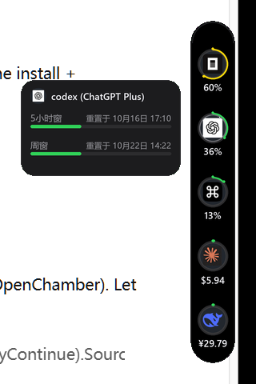

# Agent Quota Pill（AI 套餐额度胶囊）

> Windows 桌面上的「灵动岛」式 AI 编程套餐额度监控。
> **一条胶囊，统管三类计费：中转站余额、官方充值账号、Coding Plan 订阅额度。**

<p align="center">
  
</p>

## 这是什么

你同时用着好几个 AI 编程服务，但它们分散在完全不同的计费体系里：

| 计费类型 | 例子 | 余额在哪看 |
|---|---|---|
| **中转站**（API 网关） | 自建/第三方 Claude/OpenAI 中转 | 各家自有网页控制台 |
| **官方充值账号**（按量付费） | DeepSeek 官方 API、OpenAI API | 各家官网财务页 |
| **Coding Plan**（订阅套餐） | ChatGPT Plus (Codex)、OpenCode Go、Command Code GOAT | 分散在各自 CLI 的 TUI 里 |

这个小工具把三类全部聚合到桌面一条 56px 宽的黑色胶囊上：

- 平时贴在屏幕右缘只露 12px 竖条，不打扰；**鼠标碰上去滑出完整胶囊**
- 五个圆形公司头像，每个带环形用量圈（绿/黄/红按用量分级）+ 下方数值
- 订阅制显示**百分比**（如 `60%`），充值制显示**余额**（如 `$6.10`、`¥29.79`）
- **鼠标悬停任一头像 → 弹出详情卡片**：各时间窗已用比例、重置时间、余额、今日消耗
- 另有终端面板、JSON 输出、系统托盘三种形态（见下文）

零第三方依赖（tkinter + Pillow），纯 Python 标准库实现所有 API 调用；胶囊用 PIL 3 倍超采样渲染，
边缘和文字全部抗锯齿（灵动岛质感）。

## 支持的服务（内置五家，可扩展）

| 头像 | 服务 | 计费类型 | 数据来源 |
|---|---|---|---|
| OC | OpenCode Go | Coding Plan | `opencode.ai/zen/go/v1/usage` 官方端点（滚动 5h / 周 / 月三窗口） |
| GPT | OpenAI Codex (ChatGPT Plus) | Coding Plan | `chatgpt.com/backend-api/wham/usage`（5h / 周双窗口） |
| GOAT | Command Code GOAT | Coding Plan | `api.commandcode.ai/alpha/billing/credits`（余额 + 5h/周窗口） |
| CLD | Claude（经中转站） | 中转站 | 中转站的 `/v1/usage` 接口（余额 + 每日明细） |
| DSK | DeepSeek 官方 | 官方充值 | `api.deepseek.com/user/balance`（账户余额） |

> 每一家的端点、认证方式、走不走代理，都在 `scripts/quota_hud.py` 文件头的注释里有完整说明。
> **想接自己的中转站？** 见下方《教学：如何接入你的中转站》一节，方法是通用的。

## 快速开始

**要求**：Windows 10/11 · Python 3.12+ · Pillow（唯一第三方依赖）

```powershell
pip install pillow
git clone https://github.com/weitianyu816-creator/agent-quota-pill.git
cd agent-quota-pill

# 1) 终端面板（最快验证）——五家额度一屏输出
python scripts/quota_hud.py --once

# 2) 桌面胶囊（无黑窗启动）
pythonw scripts/hud_window.py
```

胶囊启动后：**右键**它 → 「安装开机自启」即可常驻；右键菜单还含 立即刷新 / 置顶开关 /
停靠右缘开关 / 打开终端面板 / 退出。

### 命令行开关

```powershell
python scripts/quota_hud.py            # 终端面板单次输出
python scripts/quota_hud.py --watch    # 循环刷新（默认 300s）
python scripts/quota_hud.py --json     # 机器可读（可喂给别的工具/脚本）
python scripts/quota_hud.py --tray     # 系统托盘图标形态

pythonw scripts/hud_window.py --dock 0            # 关闭右缘停靠，变成自由摆放
pythonw scripts/hud_window.py --no-topmost        # 不置顶
pythonw scripts/hud_window.py --interval 120      # 刷新间隔（秒）
pythonw scripts/hud_window.py --regen-avatars     # 重新下载/生成五家头像缓存
```

## 配置各家凭据（逐家教学）

工具**不会**替你登录，也不要求你填任何表单。它读取你机器上**现有的登录态**，
和各家 CLI 自己用的凭据是同一份。你平时怎么用这些 CLI，这里就怎么读：

| 服务 | 凭据位置（自动读取） | 怎么获得 |
|---|---|---|
| OpenCode Go | `~/.local/share/opencode/auth.json` | 装 OpenCode CLI 并登录（`opencode` 首次运行会引导） |
| Codex (Plus) | `~/.codex/auth.json` | 装 Codex CLI 并 `codex login`（ChatGPT 账号） |
| Command Code | 环境变量 `COMMAND_CODE_API_KEY` | commandcode.ai 控制台生成 API Key，然后 `setx COMMAND_CODE_API_KEY "..."` |
| DeepSeek 官方 | 环境变量 `DEEPSEEK_API_KEY` | platform.deepseek.com 创建 API Key，`setx DEEPSEEK_API_KEY "..."` |
| Claude 中转站 | 文件 `~/.bbapi_key` 或环境变量 `BB_API_KEY` | 你的中转站控制台复制 Key，存成主目录下 `.bbapi_key` 纯文本一行即可 |

> 没配的源不会导致程序崩溃：对应头像变灰、卡片显示一行原因，其余照常工作。

## 教学：如何接入你的中转站

中转站（API 网关）五花八门：有的是 one-api/new-api 公开部署，有的是自研前端。
不存在一套「标准余额接口」，但**定位接口的方法论是通用的**，三步：

**第一步：未认证探测分路。** 用候选路径列表请求一次（不带 Key），看状态码：

- `401 / 403` → **路由存在**，只差认证（这就是要找的）
- `404` → 路由不存在，换下一个

```powershell
# 候选路径一轮扫（把 HOST 换成你的中转域名）
foreach ($p in "/v1/usage","/api/user/self","/v1/dashboard/billing/subscription","/api/balance") {
  $code = (curl.exe -s -o NUL -w "%{http_code}" "https://HOST$p")
  Write-Output "$code $p"
}
```

**第二步：带你的 Key 请求命中的那个路径**，看返回结构：

```powershell
curl.exe -s -H "Authorization: Bearer <你的Key>" https://HOST/v1/usage
```

**第三步：把新源加进 `quota_hud.py`**。每个数据源就是一个 `fetch_xxx(proxy)` 函数，
返回统一结构 `{"ok": True, "balance": ..., "windows": [...]}`，然后注册进
`collect()` 的列表即可。照抄 `fetch_deepseek()`（最简单的一个，不到 40 行）改三处：
URL、认证头、响应字段映射。

> 进阶侦察技巧（本项目的端点就是这么找到的）：
> ① 如果目标 CLI 是 npm 包，直接 `grep -r "/alpha\|/api" node_modules/<包>/dist`，
> 源码里藏着全部真实端点；
> ② 如果只有网页控制台，下载它的 `index-*.js` bundle，grep 出所有 `"/xxx"` 路由串。
> 实测比开浏览器抓包快十倍。

## 常见问题

**Q: 胶囊模糊/文字发虚？**
确认系统缩放和 Python 的 DPI 设置：本工具启动时已自动声明 DPI 感知（`SetProcessDpiAwareness`），
且 UI 全部由 PIL 超采样渲染。如果仍糊，多半是远程桌面（RDP）缩放所致。

**Q: 鼠标放上去胶囊闪来闪去？**
v3 已彻底修复（收回逻辑改为指针位置轮询，不再依赖窗口离开事件）。
如果你用的是旧版，请更新到最新提交。

**Q: 某些头像变成字母徽章（如蓝色的 G）？**
头像是启动时从官网拉取的，网络不通就回退为品牌色字母徽章（不影响功能）。
恢复方式：挂好代理后 `pythonw scripts/hud_window.py --regen-avatars`。

**Q: 哪些源需要代理？**
ChatGPT（Codex）与 OpenCode 的端点需要代理访问，默认读 `http://127.0.0.1:7897`，
可用 `--proxy` 或环境变量 `QUOTA_HUD_PROXY` 覆盖；DeepSeek、Command Code、
国内中转站为直连源（代码内写死不走代理）。

**Q: 数据多久刷新一次？会不会频繁请求被限流？**
默认 300 秒一次。每个源每次只发 1~2 个轻量 GET 请求，全部走只读接口
（不启动任何对话、不消耗额度）。

## 隐私与安全

- **所有密钥只在你本机读取、只用于请求对应服务的官方接口**；不打印、不落盘、不上传
- 工具无后端、无遥测、无账号体系
- 只读设计：不会刷新/轮换/修改你的任何凭据，也永远不会代替你发起计费请求

## 免责声明

本项目为个人开发者工具，与 OpenAI / Anthropic / DeepSeek / OpenCode / Command Code
等各服务商无隶属关系。各产品名称与图标（logo）版权归其各自所有者，本仓库内的头像
仅作个人本机识别用途，来源为各官网公开 favicon。

## License

[MIT](LICENSE)

---

<details>
<summary><b>English quick start</b></summary>

**Agent Quota Pill** — a Dynamic-Island-style desktop widget for Windows that shows your
remaining quota across three billing types at once: **relay/API-gateway balance**,
**official pay-as-you-go balance**, and **coding-plan subscriptions** (ChatGPT Plus/Codex,
OpenCode Go, Command Code GOAT).

Requirements: Windows 10/11, Python 3.12+, Pillow.

```powershell
pip install pillow
python scripts/quota_hud.py --once      # terminal panel
pythonw scripts/hud_window.py           # desktop pill (docks to the right screen edge)
```

Credentials are read from the CLIs you already use (`~/.codex/auth.json`,
`~/.local/share/opencode/auth.json`, env `COMMAND_CODE_API_KEY`, `DEEPSEEK_API_KEY`,
or `~/.bbapi_key` for your relay). Everything is local, read-only, and no data leaves
your machine except direct requests to each provider's own usage endpoint.

To add your own relay: probe candidate paths unauthenticated (401 = exists, 404 = not),
then copy the `fetch_deepseek()` pattern in `scripts/quota_hud.py`.

</details>
